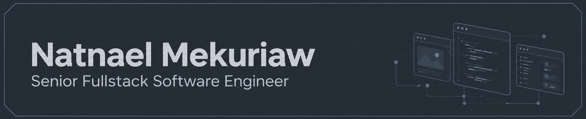
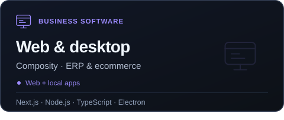
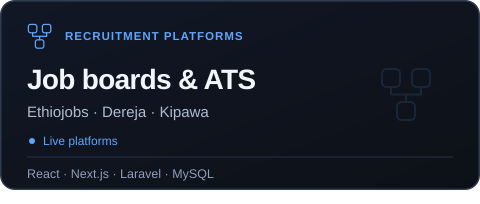
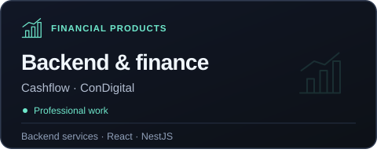
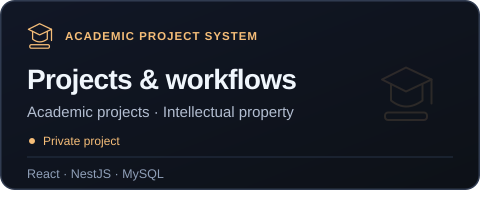
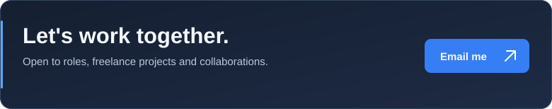

<picture>
  <source media="(max-width: 600px)" srcset="./assets/profile-banner-muted-mobile.png">
  
</picture>

  
  
  

I build reliable <strong>web applications, APIs and desktop software</strong> — from architecture through delivery.

  
  
  

## Core skills

  <strong>Frontend</strong> 
  
  
  
  

  <strong>Backend & APIs</strong> 
  
  
  
  
  

  <strong>Testing</strong> 
  
  
  

## Architectures

  
  
  
  

## Databases & ORMs

  
  
  
  
  

<strong>More technologies &amp; tools</strong>

  <strong>Primary languages & web standards</strong> 
  

**UI libraries & state management**

  
  
  
  
  

**Database administration**

  
  

**Development & delivery**

  

**API documentation & testing tools**

  
  

Unit, integration, API and end-to-end testing.

**Desktop & mobile**

  
  

Additional desktop application experience with Java and C++.

**Integrations & automation**

  
  
  
  

HelloCash integration · Telegram webhooks and polling.

**Additional languages**

**Design & engineering practices**

  
  
  

## Selected work

  
  
  
  

<strong>View project details</strong>

### Business software · Composity

Led development of business software across cloud-based web systems and cross-platform Electron desktop applications for local use. Worked across ERP and ecommerce products, with automated tests using Playwright, Jest and Supertest.

**Stack:** Next.js, Node.js, TypeScript and Electron. [Visit Composity](https://composity.com/en).

### Recruitment platforms · Info Mind Solutions

Led work on job boards and an applicant tracking system across Ethiojobs, Dereja and Kipawa. Built recruitment workflows and supporting features, including AI and payment integrations, data sourcing and Telegram automation.

**Stack:** React, Next.js, Laravel, MySQL and Docker. 
**Products:** [Ethiojobs](https://ethiojobs.net/) · [Dereja](https://www.dereja.com/) · [Kipawa](https://kipawa.io/) · [ATS](https://ats.ethiojobs.net/).

### Financial products · Cashflow & ConDigital

At **Cashflow**, worked as a senior backend engineer on multiple backend systems and services for financial products. At **ConDigital**, developed finance and accounting software using React and NestJS.

### Academic Project Management System

Led development of a system for managing academic projects and intellectual property workflows, using React, NestJS and MySQL. Source code is private.

### Independent work

- **Upwork · November 2022–present:** Fullstack development using React, Next.js, NestJS and Prisma.
- **EthioFreelance:** Talent marketplace with local payment integration.
- **Hagerly:** Marketplace for digital content and assets.

Some professional source code is private. [Explore my portfolio](https://natnael-portfolio.vercel.app/) for more context.

## GitHub activity

  <a href="https://github.com/natnaelmekuriaw">
    <picture>
      <source media="(max-width: 600px)" srcset="https://streak-stats.demolab.com?user=natnaelmekuriaw&hide_current_streak=false&hide_border=true&background=0D1117&sideNums=AEBFD2&sideLabels=B7C5D8&currStreakNum=AEBFD2&currStreakLabel=B7C5D8&ring=60A5FA&fire=60A5FA&dates=79869B&stroke=263244&border_radius=12&card_height=170&disable_animations=true&timezone=Africa%2FNairobi&card_width=480&v=2026-10-15">
      
    </picture>
  </a>

<!-- 

<strong>View detailed GitHub activity</strong>
 -->

  

  
  

  

<!-- 
 -->

  <a href="mailto:natnaelmekuriaw50@gmail.com">
    <picture>
      <source media="(max-width: 600px)" srcset="./assets/contact-mobile.svg">
      
    </picture>
  </a>

  
  

