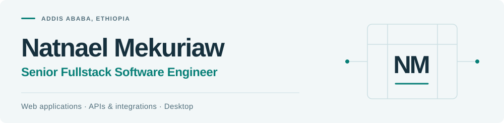

<picture>
  <source media="(prefers-color-scheme: dark) and (max-width: 600px)" srcset="./assets/header-dark-mobile.svg">
  <source media="(max-width: 600px)" srcset="./assets/header-light-mobile.svg">
  <source media="(prefers-color-scheme: dark)" srcset="./assets/header-dark.svg">
  
</picture>

  <a href="https://natnael-portfolio.vercel.app/"><strong>Portfolio</strong></a>
  &nbsp; · &nbsp;
  <a href="https://www.linkedin.com/in/natnael-mekuriaw-504361178/">LinkedIn</a>
  &nbsp; · &nbsp;
  <a href="mailto:natnaelmekuriaw50@gmail.com">Email</a>

I'm a software engineer with **4+ years of experience** turning business requirements into working products. My work spans recruitment platforms, business software and financial systems — from the interface and data model to APIs, integrations and automated tests.

I enjoy owning features end to end and making complex workflows easier to use and maintain.

## Selected work

### Business software · [Composity](https://composity.com/en)

Led development of **business software for web and desktop**, including cloud-based systems and cross-platform Electron apps for local use. Worked across ERP and ecommerce products, with automated tests using Playwright, Jest and Supertest.

Next.js · Node.js · TypeScript · Electron

### Recruitment platforms · Info Mind Solutions

Led work on **job boards and applicant tracking** across [Ethiojobs](https://ethiojobs.net/), [Dereja](https://www.dereja.com/), [Kipawa](https://kipawa.io/) and an [ATS](https://ats.ethiojobs.net/). Built recruitment workflows and supporting features, including AI and payment integrations, data sourcing and Telegram automation.

React · Next.js · Laravel · MySQL · Docker

### Financial products · Cashflow & ConDigital

At **Cashflow**, worked as a senior backend engineer on multiple backend systems and services for financial products. At **ConDigital**, developed finance and accounting software using React and NestJS.

<strong>More projects & independent work</strong>

- **Academic Project Management System** — Led development of a system for managing academic projects and intellectual property workflows.
- **EthioFreelance** — Worked on a talent marketplace with local payment integration.
- **Hagerly** — Contributed to a marketplace for digital content and assets.
- **Freelance development** — Building fullstack applications through Upwork since November 2022, using React, Next.js, NestJS and Prisma.

Some of my professional work lives in private repositories. My [portfolio](https://natnael-portfolio.vercel.app/) provides more context.

## Tech stack

**Frontend** &nbsp; React · Next.js · Vue.js · TypeScript · Tailwind CSS · Redux Toolkit 
**Backend & data** &nbsp; Node.js · NestJS · Express · Laravel · MySQL · MongoDB · Prisma 
**Quality & delivery** &nbsp; Playwright · Jest · Supertest · Docker · Git · Linux · Swagger

Additional tools & languages

JavaScript · PHP · HTML/CSS · Python · Java · C++ · MUI · Ant Design · Vuetify · Bootstrap · SQLite · Eloquent · Postman

---

**Have a product or a role in mind?** I'm open to senior fullstack opportunities and thoughtful product collaborations. [Let's talk](mailto:natnaelmekuriaw50@gmail.com)
